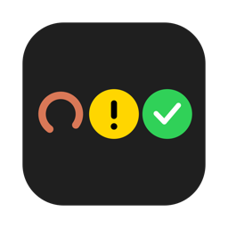

<p align="center"></p>

# ClaudeBar

Lo stato di **Claude Code** nella **Touch Bar** del MacBook Pro: vedi a colpo d'occhio se Claude sta lavorando, ha finito o aspetta te. Quando chiede un permesso puoi rispondere **Approva** o **Nega** direttamente dalla barra, senza tornare alla finestra. Resta visibile con qualsiasi app in primo piano.


**[⬇️ Scarica l'ultima versione](https://github.com/AlbyToniolo-byte/claudebar/releases/latest)**

> Progetto personale, non ufficiale: non è affiliato con Anthropic.

## Come si usa

Il simbolo sta nella **Control Strip**, a destra della Touch Bar, accanto a luminosità e volume. Non ha finestra né icona nel Dock.


| Simbolo | Significa |
|---|---|
| arco arancione che gira | Claude sta lavorando |
| `!` giallo che pulsa | aspetta te: un permesso o una domanda |
| spunta verde | ha finito |
| anello grigio | nessuna sessione aperta |

Con più sessioni aperte il simbolo mostra la più urgente. Toccalo per vedere la lista: progetto per progetto, chi lavora, chi aspetta, chi ha finito.

### Permessi dalla barra

Quando Claude chiede il permesso per un comando, la barra si apre da sola con il progetto, il comando e tre tasti:


| Tasto | Cosa fa |
|---|---|
| **Approva** | il comando parte |
| **Nega** | Claude riceve un no e va avanti |
| **Terminale** | non decide la barra: rispondi nel dialogo normale |

Dopo la risposta la barra si richiude (o torna alla lista, se l'avevi aperta tu). Se non tocchi niente per 2 minuti, o rispondi altrove, decide il dialogo normale come sempre.

## Installazione

Serve un **MacBook Pro con Touch Bar** e **macOS 13** o successivo (Apple Silicon o Intel).

1. Scarica `ClaudeBar.zip` dall'[ultima release](https://github.com/AlbyToniolo-byte/claudebar/releases/latest), estrai e sposta **ClaudeBar** in **Applicazioni** (gli hook la cercano lì).
2. L'app non è firmata con un certificato Apple, quindi al primo avvio macOS la blocca: apri **Impostazioni di Sistema → Privacy e sicurezza** e premi **Apri comunque**. In alternativa, dal Terminale:
   ```bash
   xattr -dr com.apple.quarantine /Applications/ClaudeBar.app
   ```
3. Aprila: il simbolo compare nella Control Strip e l'app si registra per ripartire a ogni accesso. Se non lo vedi, controlla che in **Impostazioni di Sistema → Tastiera → Impostazioni Touch Bar** la Touch Bar mostri la Control Strip.
4. Collega Claude Code: in `~/.claude/settings.json`, dentro `"hooks"`, aggiungi lo stesso comando per ogni evento. Se un evento ha già i suoi hook (es. `Stop`), aggiungi solo la riga del comando nella sua lista.

```json
{
  "hooks": {
    "UserPromptSubmit":  [{ "hooks": [{ "type": "command", "command": "/Applications/ClaudeBar.app/Contents/MacOS/ClaudeBar --hook" }] }],
    "PreToolUse":        [{ "hooks": [{ "type": "command", "command": "/Applications/ClaudeBar.app/Contents/MacOS/ClaudeBar --hook" }] }],
    "PostToolUse":       [{ "hooks": [{ "type": "command", "command": "/Applications/ClaudeBar.app/Contents/MacOS/ClaudeBar --hook" }] }],
    "PermissionRequest": [{ "hooks": [{ "type": "command", "command": "/Applications/ClaudeBar.app/Contents/MacOS/ClaudeBar --hook", "timeout": 600 }] }],
    "Notification":      [{ "hooks": [{ "type": "command", "command": "/Applications/ClaudeBar.app/Contents/MacOS/ClaudeBar --hook" }] }],
    "Stop":              [{ "hooks": [{ "type": "command", "command": "/Applications/ClaudeBar.app/Contents/MacOS/ClaudeBar --hook" }] }],
    "StopFailure":       [{ "hooks": [{ "type": "command", "command": "/Applications/ClaudeBar.app/Contents/MacOS/ClaudeBar --hook" }] }],
    "SessionEnd":        [{ "hooks": [{ "type": "command", "command": "/Applications/ClaudeBar.app/Contents/MacOS/ClaudeBar --hook" }] }]
  }
}
```

Le sessioni già aperte leggono i nuovi hook da sole, senza riavviare.

Per disinstallare: togli prima questi hook, poi cancella l'app. Senza l'app, Claude Code segnalerebbe un errore a ogni evento.

## Privacy

Tutto resta sul tuo Mac: niente rete, niente permessi di sistema. Per ogni sessione ClaudeBar salva in `~/Library/Application Support/ClaudeBar/` solo il nome della cartella del progetto, lo stato e, per i permessi, le prime 90 lettere del comando da mostrare nella barra. La sessione viene cancellata quando la chiudi.

## Compilare dal codice

Bastano gli strumenti da riga di comando di Xcode (`xcode-select --install`).

```bash
./build.sh           # esegue i test, crea ClaudeBar.app (universale) con l'icona
./build.sh install   # come sopra, poi la copia in Applicazioni e la avvia
```

Tutto il programma è in [`main.swift`](main.swift). Per provarlo senza Claude Code si possono mandare eventi finti all'hook:

```bash
H=/Applications/ClaudeBar.app/Contents/MacOS/ClaudeBar
echo '{"session_id":"prova","cwd":"/tmp/demo","hook_event_name":"PreToolUse"}' | $H --hook   # lavora
echo '{"session_id":"prova","cwd":"/tmp/demo","hook_event_name":"Stop"}' | $H --hook         # finito
echo '{"session_id":"prova","cwd":"/tmp/demo","hook_event_name":"PermissionRequest","tool_name":"Bash","tool_input":{"command":"ls"}}' | $H --hook   # Approva/Nega
```

`-expand YES` fa partire l'app con la barra già aperta.

## Come funziona

- **Un solo eseguibile, due ruoli**: Claude Code lancia `ClaudeBar --hook` a ogni evento; l'hook legge l'evento da stdin, scrive un piccolo file JSON ed esce in circa 20 ms. L'app accesa legge quei file 5 volte al secondo. Niente server né porte.
- **Permessi**: l'hook di `PermissionRequest` crea un file di richiesta (con il proprio pid) e aspetta il file di risposta scritto dai tasti della barra, poi restituisce a Claude Code la decisione (`allow` o `deny`). Se l'app è spenta, se rispondi altrove o dopo 2 minuti esce senza decidere, e resta il dialogo normale. Se Claude Code interrompe l'hook, l'app se ne accorge dal pid e toglie la richiesta.
- **Sempre visibile**: la Touch Bar normale mostra solo i controlli dell'app in primo piano. Per restare nella Control Strip ClaudeBar usa alcune funzioni private di macOS (dichiarate in [`private.h`](private.h)), lo stesso metodo di app come Pock e MTMR. Per questo non può stare sull'App Store, e un futuro aggiornamento di macOS potrebbe romperle.
- **Test**: la logica (quale stato scrive ogni evento, la risposta JSON per Claude Code) è in funzioni pure, controllate a ogni compilazione.
- **Consumo**: il simbolo si ridisegna solo mentre gira o pulsa.

Dello stesso autore, sempre per la Touch Bar: [TouchPet](https://github.com/AlbyToniolo-byte/touchpet) e [Jurassic Run](https://github.com/AlbyToniolo-byte/jurassic-run).
